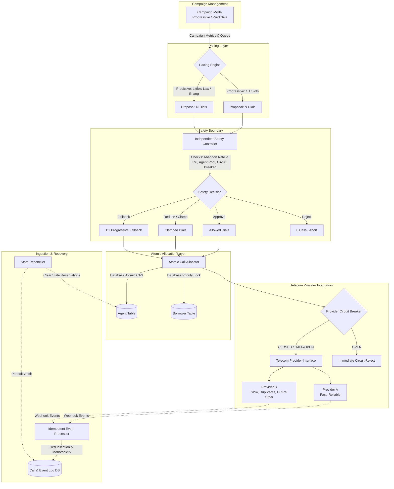
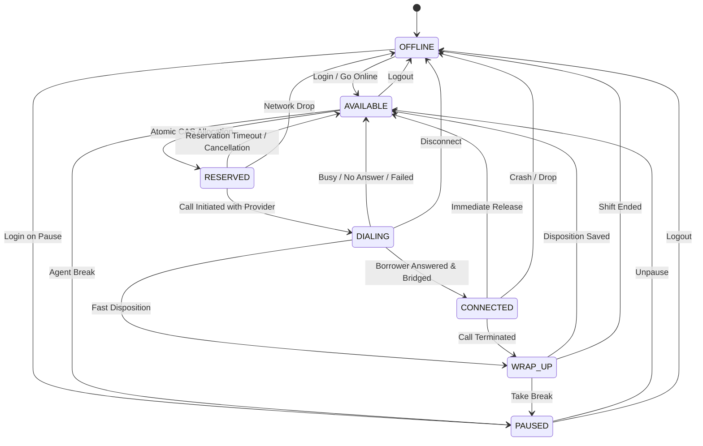
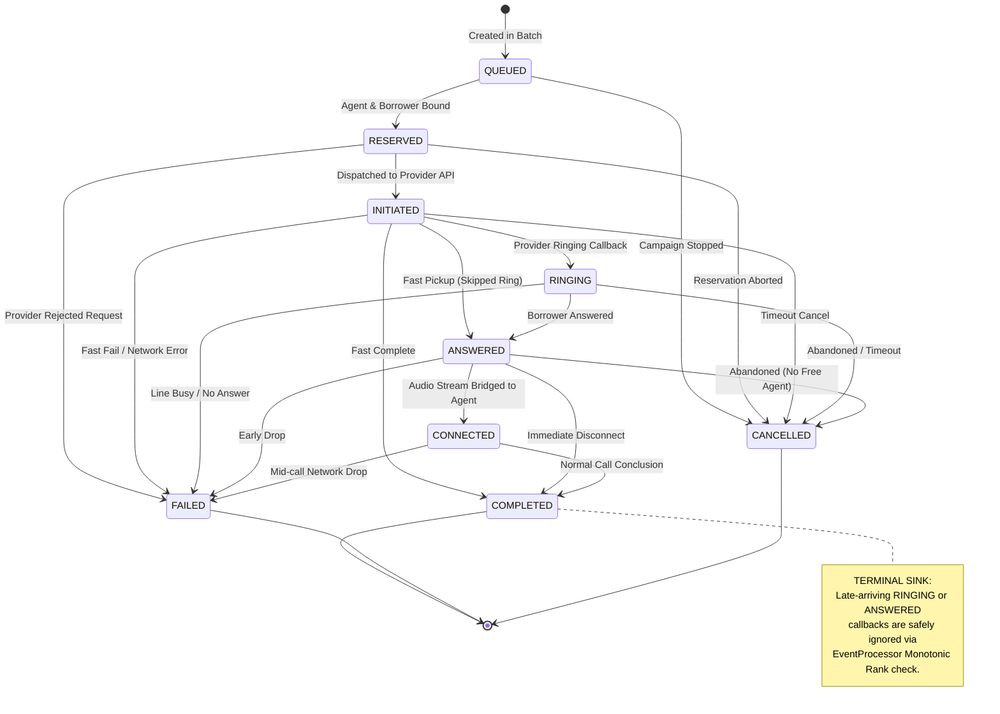

# CredResolve SmartDialer - Architecture & State Machine Diagrams

## 1. System Pipeline Architecture



---

## 2. Agent State Machine



---

## 3. Call State Machine & Monotonic Progression



---

## 4. Crash Recovery & Stale State Reconciliation

```mermaid
sequenceDiagram
    autonumber
    participant W1 as Worker 1 (Active)
    participant DB as Central Database
    participant REC as State Reconciler
    participant AGT as Agent 101

    W1->>DB: Atomic CAS: Reserve Agent 101 (status=AVAILABLE -> RESERVED)
    DB-->>W1: 1 Row Updated (Worker 1 holds reservation)
    W1->>DB: Atomic CAS: Reserve Borrower (status=PENDING -> RESERVED)
    DB-->>W1: 1 Row Updated
    Note over W1: WORKER 1 PROCESS CRASHES SUDDENLY!
    Note over AGT,DB: Agent 101 stuck in RESERVED with no active call

    REC->>DB: Periodic Sweep: SELECT * FROM agents WHERE status='RESERVED' AND reserved_at &lt; NOW() - 15s
    DB-->>REC: Returns Agent 101
    REC->>DB: UPDATE agents SET status='AVAILABLE', reserved_by=NULL WHERE id=101
    REC->>DB: UPDATE borrowers SET status='PENDING' WHERE id=borrower_id
    Note over REC,DB: System recovered cleanly; zero leaked locks or orphaned resources!
```
